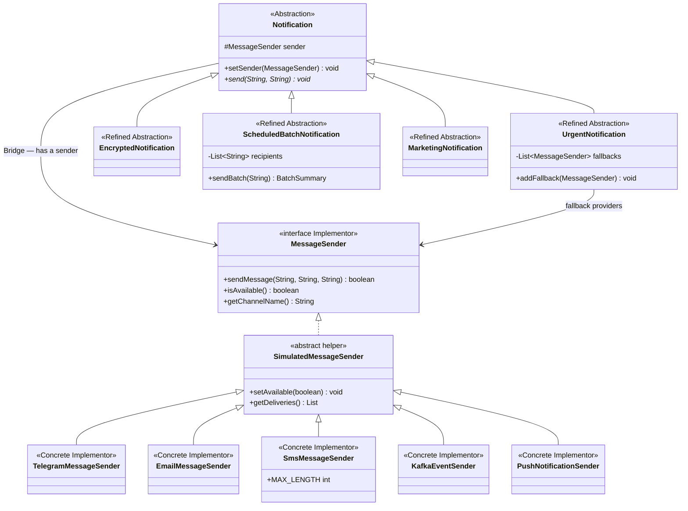

# Multi-Channel Notification Gateway

Assignment 3 — Bridge Pattern · Java 17 · Maven · JUnit 5

A console application that separates **notification behavior** from **delivery channels**. All providers are simulated: no API keys, network calls, accounts, or real messages are required.

## Quick start

For the included prebuilt demo, install Java 17 or newer and run:

```sh
java -jar dist/notification-gateway-1.0.0.jar
```

To build from source and run the tests, use JDK 17+ and Maven 3.8+:

```sh
mvn clean test
mvn package
java -jar target/notification-gateway-1.0.0.jar
```

Alternatively run `mvn compile exec:java`, `sh run.sh` on macOS/Linux, or `run.bat` on Windows. Maven needs internet for its first dependency download. IntelliJ IDEA: open `pom.xml` as a project, select JDK 17, load Maven, and run `Demo.main` or `GatewayTest`.

## Mandatory demo scenarios

`Demo.java` prints numbered sections:

| # | Scenario | Observable result |
|---|---|---|
| 1 | Urgent + Telegram | Formatted Telegram payload with `[URGENT]` |
| 2 | Encrypted + Email | Base64 body, subject and email signature |
| 3 | Scheduled batch + SMS | Three recipients, including an invalid one; Total 3, Successful 2, Failed 1 |
| 4 | Runtime Telegram → Email | The same `urgent` object sends via two different providers |
| 5 | Telegram unavailable → SMS | Availability check skips Telegram; SMS fallback succeeds |
| 6 | Marketing + Push | Promotional banner with unsubscribe text |
| 7 | Urgent + Kafka | Simulated JSON event published to `notifications` |
| 8 | SMS restriction | 161-character body is rejected |

## Architecture and Bridge roles

| Role | Classes |
|---|---|
| Abstraction | `Notification` |
| Refined Abstractions | `UrgentNotification`, `EncryptedNotification`, `ScheduledBatchNotification`, `MarketingNotification` |
| Implementor | `MessageSender` |
| Concrete Implementors | `TelegramMessageSender`, `EmailMessageSender`, `SmsMessageSender`, `KafkaEventSender`, `PushNotificationSender` |
| Shared simulation helper | `SimulatedMessageSender` |
| Value objects | `SentMessage`, `BatchSummary` |

The UML source is [docs/class-diagram.puml](docs/class-diagram.puml). A ready-to-view image is [docs/class-diagram.png](docs/class-diagram.png). The same architecture renders below on GitHub.



### What are the two independent dimensions?

Notification behavior (urgent, encoded, batch, marketing) and transport implementation (Telegram, Email, SMS, Kafka, Push). Behavior decides what to send; the transport decides how to represent and deliver it.

### Where exactly is the Bridge?

The `protected MessageSender sender` field in `Notification`, constructor injection, and delegation to `sender.sendMessage(...)` form the Bridge. `setSender(...)` replaces that reference at runtime. The notification hierarchy depends on the interface, not concrete providers.

### Why is inheritance problematic here?

Creating `UrgentTelegramNotification`, `UrgentEmailNotification`, and similar combination classes couples both dimensions. With 4 behaviors and 5 channels, this could require 20 combination classes. Bridge needs 4 behavior classes and 5 channel classes, plus shared contracts and helpers. New combinations are assembled from objects.

### What happens when a new provider is added?

Add a class implementing `MessageSender` (or extending the optional simulation helper), then inject it into any existing notification. `PushNotificationSender` is the independent provider extension: it introduces device/banner formatting without changes to notification classes. The tests also exercise Push with the existing encoded notification.

### What happens when a new notification type is added?

Extend `Notification`, transform the content, and delegate through `MessageSender`. `MarketingNotification` is the independent behavior extension: it adds a promotion prefix, title, and unsubscribe text without changes to existing senders. Tests exercise it with both existing Email and new Push. The full matrix test verifies all 20 behavior/channel combinations with short valid messages.

### Why is this Bridge rather than Adapter?

Bridge deliberately designs two collaborating hierarchies that vary independently. Adapter converts an existing incompatible API into an expected interface. This project does not wrap an incompatible legacy API; each provider implements the agreed transport contract directly through the simulation helper.

## Behavioral decisions

- Availability is configurable on every simulated sender with `setAvailable(false)`.
- `sendMessage` returns `false` for unavailability, null/blank recipients, null title/body, or provider restrictions. It records only successful deliveries. Addresses are opaque identifiers; real email/phone validation is outside this simulation.
- Urgent checks availability before sending and tries fallback providers in order, both when the primary is unavailable and when it returns `false`. Fallback does not change the primary sender and uses no `instanceof`. When all attempts fail, the result is printed and `wasLastDeliverySuccessful()` is false.
- SMS sends the body only and rejects bodies above `MAX_LENGTH = 160`. It counts Unicode code points, a simplified assignment model rather than real GSM/Unicode segment rules. Notification prefixes count toward the limit.
- `EncryptedNotification` performs UTF-8 Base64 transformation before delegation, as allowed by the assignment. **Base64 is encoding, not secure encryption.**
- `ScheduledBatchNotification` stores a collection and dispatches it explicitly with `sendBatch(message)`. A background clock/timer is not required by the listed batch requirements and is not implemented. Each configured entry is one delivery attempt; invalid recipients are counted as failures. Summaries reset for every dispatch.
- The inherited `send(recipient, message)` method sends to the stored collection plus the supplied nonblank recipient if not already present, for that dispatch only. Use `sendBatch` when sending only to the configured collection.
- Kafka publishes a simulated JSON event with quote, backslash, and control-character escaping. There is no broker dependency.
- Delivery history is exposed as an immutable snapshot for verification. This is a single-threaded teaching simulation; there is no persistence, queue worker, or automatic retry service.

## Tests

`src/test/java/com/example/gateway/GatewayTest.java` contains **25 JUnit 5 tests** covering successful delivery, availability, urgent prefixes, fallback order and failure, exact SMS boundaries and Unicode, UTF-8 Base64 transformation, batch partial/total failure, runtime switching, Push, Marketing, Kafka escaping, invalid input, immutable history, and all 20 behavior/channel combinations.

Run `mvn test`. Local execution details and the test summary are in [docs/verification.txt](docs/verification.txt); a captured demo is in [docs/demo-output.txt](docs/demo-output.txt).

## Project layout

- `src/main/java/com/example/gateway/Demo.java` — numbered demonstration
- `src/main/java/com/example/gateway/notification/` — abstraction hierarchy
- `src/main/java/com/example/gateway/sender/` — implementor hierarchy
- `src/test/java/com/example/gateway/GatewayTest.java` — JUnit 5 tests
- `docs/class-diagram.puml` — editable UML source
- `docs/DEFENSE_RU.md` — short Russian explanation and change examples
- `dist/notification-gateway-1.0.0.jar` — prebuilt Java 17 demo
- `pom.xml` — Maven dependencies and build configuration

## Submission

Create a GitHub repository, upload the contents of this project folder (including `README.md`, `pom.xml`, `src`, and `docs`), and submit the repository URL through Moodle. Do not upload only the ZIP or only the JAR: the source, tests, README, and UML should be visible in the repository. Add your name and group if your instructor requires them. Review `docs/DEFENSE_RU.md` and practice running the demo before the individual defense.
